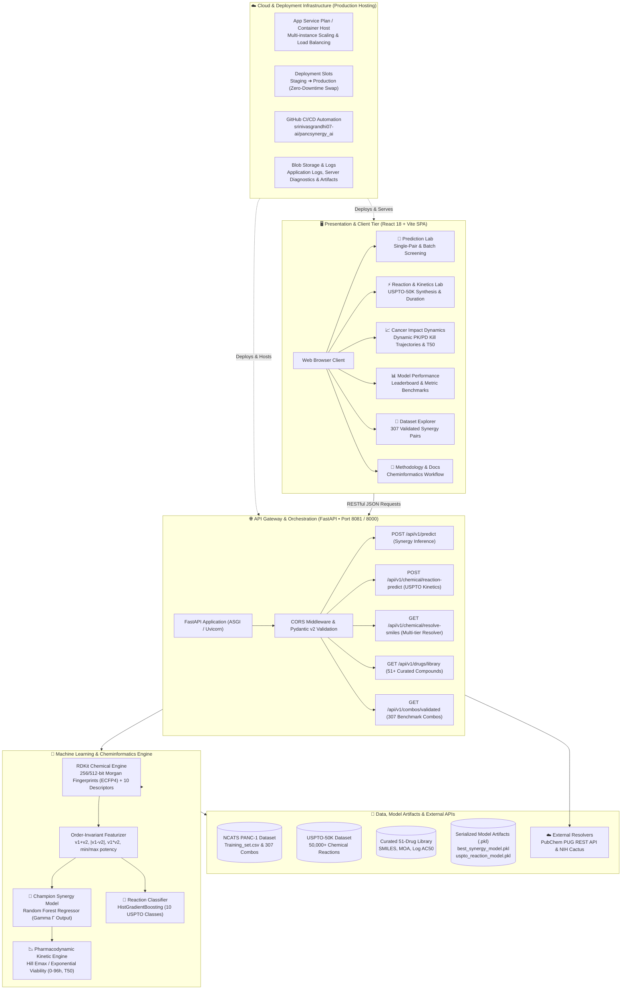

# PancSynergy AI

### Machine-learning-assisted screening of drug-combination synergy & chemical kinetics in PANC-1 pancreatic cancer cells

PancSynergy AI is an end-to-end computational oncology and cheminformatics application for predicting drug-combination synergy scores (Gamma, **Γ**), chemical reaction transformations, and real-time cancer cell kill kinetics in the PANC-1 pancreatic cancer context. It combines molecular descriptors, 256/512-bit Morgan fingerprints, single-agent potency inputs, and USPTO reaction models, presented through a responsive React dashboard and RESTful API.

> **Research-use notice:** PancSynergy provides computational estimates derived from in-vitro and patent reaction data. Predictions are computational hypotheses and do not replace laboratory confirmation, clinical trials, or medical diagnosis. All candidate combinations require formal experimental validation before biological or clinical conclusions are drawn.

> 📘 **Theoretical Manual & Math Guide:** For a comprehensive, rigorous breakdown of the machine learning algorithms, mathematical derivations, Morgan fingerprint circular hashing, symmetric pair feature math, data cleaning steps, and continuous pharmacodynamic kill kinetics, refer to the dedicated [**THEORY.md**](THEORY.md) documentation.

---

## Table of contents

- [Features](#features)
- [How it works](#how-it-works)
- [Complete System Architecture](#complete-system-architecture)
  - [Tailored Architectural Blueprint](#tailored-architectural-blueprint)
  - [Component Walkthrough](#component-walkthrough)
  - [Cloud Reference Architecture Mapping](#cloud-reference-architecture-mapping)
- [Data Cleaning and Preprocessing Pipeline](#data-cleaning-and-preprocessing-pipeline)
  - [1. PANC-1 Synergy Matrix Cleaning (`Training_set.csv`)](#1-panc-1-synergy-matrix-cleaning-trainingsetcsv)
  - [2. Molecular Structure Validation & Canonicalization](#2-molecular-structure-validation--canonicalization)
  - [3. Order-Invariant (Symmetric) Feature Engineering](#3-order-invariant-symmetric-feature-engineering)
  - [4. USPTO-50K Chemical Reaction Cleaning (`USPTO_50K.csv`)](#4-uspto-50k-chemical-reaction-cleaning-uspto_50kcsv)
  - [5. Curated 51-Drug Library & Multi-Tier SMILES Resolver](#5-curated-51-drug-library--multi-tier-smiles-resolver)
- [Gamma interpretation](#gamma-interpretation)
- [Reaction Kinetics & Chemical Synthesis Lab (USPTO-50K)](#reaction-kinetics--chemical-synthesis-lab-uspto-50k)
- [Cancer Impact Dynamics & Pharmacodynamics Lab](#cancer-impact-dynamics--pharmacodynamics-lab)
- [Model Evaluation & Benchmark Insights](#model-evaluation--benchmark-insights)
  - [Evaluation Snapshot & Score Distribution](#evaluation-snapshot--score-distribution)
  - [Top Synergistic Pairs & Mechanism Frequencies](#top-synergistic-pairs--mechanism-frequencies)
  - [5-Fold Cross-Validation & Test Benchmarks](#5-fold-cross-validation--test-benchmarks)
- [Technology stack](#technology-stack)
- [Repository structure](#repository-structure)
- [Setup and run](#setup-and-run)
- [REST API](#rest-api)
- [Data and reproducibility](#data-and-reproducibility)
- [Known limitations](#known-limitations)
- [Responsible use](#responsible-use)
- [License](#license)

---

## Features

- **Single-Pair Synergy Prediction:** Enter any two compound names, molecular SMILES, and Log AC50 potencies to calculate the continuous Gamma score (Γ) with Random Forest inference.
- **Batch Screening:** High-throughput computational evaluation of large drug combination matrices.
- **Validated Combination Explorer:** Browse validated synergy combinations from the NCATS PANC1 benchmark dataset.
- **Model Performance Leaderboard:** Review 5-fold cross-validation and held-out test benchmarks across Linear, Tree Ensemble, and Deep Learning models.
- **Chemical Reaction & Kinetics Lab:** Predict the chemical reaction feasibility, reaction transformation class (USPTO-50K), estimated combination time (hours), recommended temperature, solvent, catalysts, and expected yield for any two reactant molecules.
- **Cancer Impact Dynamics & Time-Course Lab:** Pharmacodynamic Hill/exponential kill simulation mapping cancer viability trajectories over 48h to 96h, half-maximal eradication time ($T_{50}$), apoptotic triggers, and synergy kill gain across 51+ PANC-1 oncology drugs.
- **Multi-Tier SMILES Resolver:** Auto-fetch molecular SMILES by generic drug name via local curated PANC-1 library $\rightarrow$ PubChem PUG REST API $\rightarrow$ NIH Cactus Chemical Resolver.
- **RESTful Architecture:** Modular endpoints serving prediction, reaction kinetics, chemical properties, and drug libraries on port `8081` (or `8000`).

---

## How it works

1. **Input Compounds:** Each drug is represented by a SMILES string and an optional single-agent potency value (`Log AC50 (M)`).
2. **Molecular Descriptor Extraction:** RDKit generates 256-bit Morgan fingerprints (radius 2) and 10 2D physicochemical descriptors (MW, LogP, TPSA, HBD, HBA, Rotatable Bonds, FractionCSP3, Ring Count, Aromatic Rings, Heavy Atom Count), yielding a 266-dimensional vector per compound.
3. **Symmetric Pair Representation:** To ensure order independence, compound vectors are combined using element-wise sum, absolute difference, and element-wise product, plus four potency features, generating an 802-dimensional symmetric feature representation.
4. **Predict Gamma (Γ):** The trained Random Forest regressor computes the continuous synergy score.
5. **Simulate Dynamics & Synthesis:** The score feeds into the Pharmacodynamic (PK/PD) simulator and the USPTO reaction model to predict kill velocity and synthetic combination feasibility.

$$\mathbf{x}_{\text{pair}} = \left[\mathbf{v}_A + \mathbf{v}_B,\ |\mathbf{v}_A - \mathbf{v}_B|,\ \mathbf{v}_A \odot \mathbf{v}_B,\ \min(p_A, p_B),\ \max(p_A, p_B),\ |p_A - p_B|,\ p_A + p_B\right]$$

---

## Complete System Architecture

### Tailored Architectural Blueprint

The following diagram illustrates the complete, multi-tiered architecture tailored specifically to **PancSynergy AI**—spanning the presentation layer, RESTful API gateway, machine learning inference engines, cheminformatics pipelines, and cloud deployment infrastructure:



---

### Component Walkthrough

1. **Client & Presentation Layer (Frontend):**
   * **React 18 + TypeScript + Vite:** High-performance single page application (SPA) with lightning-fast hot module replacement.
   * **Tailwind CSS & Lucide Icons:** Modern, clean, responsive user interface adapted for dense scientific data.
   * **Recharts Dynamic Data Visualizations:** Real-time rendering of in-vitro cancer survival curves, milestone speedup comparisons, and synergy distribution histograms.
   * **Inter-Page Data Bridge:** Seamless one-click transfer of evaluated chemical pairs between the **Prediction Lab**, **Reaction & Kinetics Lab**, and **Cancer Impact Dynamics**.

2. **API Gateway & Service Layer (Backend):**
   * **FastAPI + Uvicorn (ASGI):** Asynchronous Python web framework delivering sub-millisecond route dispatching on port `8081` (or `8000`).
   * **Pydantic v2 Schemas:** Strict runtime validation and serialization for molecular SMILES, potencies, and reaction parameters.
   * **Multi-Tier Chemical Identifier Resolver:** Translates drug trade names and generic identifiers to canonical SMILES via local cache $\rightarrow$ PubChem $\rightarrow$ NIH Cactus.

3. **Machine Learning & Chemical Inference Core:**
   * **RDKit Molecule Sanitizer:** Validates chemical valence, stereochemistry, and aromaticity. Extracts Morgan fingerprints (radius 2, 256/512 bits) and 2D physicochemical descriptors.
   * **Order-Invariant (Symmetric) Featurizer:** Mathematically guarantees that pair inputs $(A + B)$ and $(B + A)$ yield identical representation vectors.
   * **Random Forest Synergy Regressor (`best_synergy_model.pkl`):** Trained on NCATS PANC-1 screening data; outputs continuous Gamma ($\Gamma$).
   * **USPTO-50K Chemical Reaction Model (`uspto_reaction_model.pkl`):** HistGradientBoosting classifier mapping reactant pairs to synthetic reaction classes, combination time, temperature, and solvent conditions.
   * **Pharmacodynamic (PK/PD) Kinetic Engine:** Translates potencies and synergy multipliers into continuous cancer cell eradication trajectories over 0 to 96 hours.

4. **Data & Artifact Tier:**
   * **NCATS PANC-1 Screening Matrix:** Curated training combinations with single-agent potencies.
   * **USPTO-50K Patent Dataset:** 50,000+ validated chemical reactions with synthetic transformations.
   * **Curated 51-Drug PANC-1 Library:** Pre-indexed oncology compounds ready for instant evaluation.

---

### Cloud Reference Architecture Mapping

Below is the enterprise cloud hosting blueprint adapted to PancSynergy AI:

<div align="center">
  
  <p><em>Enterprise Cloud Architecture Blueprint (Azure App Service Plan, Deployment Slots, SQL/Blob Storage, and GitHub CI/CD)</em></p>
</div>

| Cloud Architecture Component | PancSynergy AI Mapping & Implementation |
|---|---|
| **App Service Plan & Instances** | Hosts the containerized FastAPI backend (Port 8081) and Vite static frontend with multi-instance load balancing. |
| **Deployment Slots (Staging $\rightarrow$ Production)** | Enables zero-downtime blue/green deployment; test newly trained `.pkl` models in staging before swapping to production. |
| **GitHub CI/CD Deployment** | Automated workflow pushing directly from `https://github.com/srinivasgrandhi07-ai/pancsynergy_ai.git` on branch `main`. |
| **Storage Account / Blob Containers** | Stores serialized model artifacts (`best_synergy_model.pkl`, `uspto_reaction_model.pkl`), raw datasets, and application logs. |
| **Azure SQL / Relational Store** | Persists high-throughput batch screening results, user prediction histories, and custom chemical libraries. |
| **Authentication & Access Control** | Token-based API access protecting high-throughput screening endpoints. |

---

## Data Cleaning and Preprocessing Pipeline

Data hygiene and chemical structure verification are essential to avoid garbage-in, garbage-out behavior in molecular machine learning. The repository applies a multi-stage cleaning pipeline:

### 1. PANC-1 Synergy Matrix Cleaning (`Training_set.csv`)

Located in [`data/data_loader.py`](file:///c:/Users/Srinivas/Desktop/eterpunership/ran_hack/pancsynergy_ai/data/data_loader.py):

* **Header & Whitespace Stripping:**
  ```python
  df.columns = [c.strip() for c in df.columns]
  for col in df.select_dtypes(include=["object"]).columns:
      df[col] = df[col].astype(str).str.strip()
  ```
  Removes trailing spaces, carriage returns, and encoding artifacts from compound names, mechanisms, and SMILES strings.

* **Strict Numerical Type Coercion:**
  ```python
  df["Gamma"] = pd.to_numeric(df["Gamma"], errors="coerce")
  df["Label"] = pd.to_numeric(df["Label"], errors="coerce")
  df["Log AC50 (M) 1"] = pd.to_numeric(df["Log AC50 (M) 1"], errors="coerce")
  df["Log AC50 (M) 2"] = pd.to_numeric(df["Log AC50 (M) 2"], errors="coerce")
  ```
  Forces invalid text tokens and unparseable values to `NaN`.

* **Missing Target & Invalid Structure Purging:**
  ```python
  df = df.dropna(subset=["Gamma", "Structure 1", "Structure 2"])
  df = df[(df["Structure 1"] != "") & (df["Structure 2"] != "") & 
          (df["Structure 1"] != "nan") & (df["Structure 2"] != "nan")]
  ```
  Discards any pair lacking a verified target Gamma score or missing one or both chemical structures.

* **Potency Distribution Analysis & Median Imputation:**
  ```python
  ac50_1_med = df["Log AC50 (M) 1"].median()
  ac50_2_med = df["Log AC50 (M) 2"].median()
  df["Log AC50 (M) 1"] = df["Log AC50 (M) 1"].fillna(ac50_1_med if pd.notna(ac50_1_med) else -6.0)
  df["Log AC50 (M) 2"] = df["Log AC50 (M) 2"].fillna(ac50_2_med if pd.notna(ac50_2_med) else -6.0)
  ```
  Rather than discarding valid synergy pairs with missing monotherapy potencies, values are imputed with the empirical dataset median ($-6.0\text{ M}$, the standard NCATS screening micromolar baseline).

---

### 2. Molecular Structure Validation & Canonicalization

Located in [`data/feature_extractor.py`](file:///c:/Users/Srinivas/Desktop/eterpunership/ran_hack/pancsynergy_ai/data/feature_extractor.py):

* **RDKit Molecule Verification:**
  Every SMILES string is validated via `Chem.MolFromSmiles(smiles)`. Molecules failing valence or aromaticity rules return zeroed descriptors rather than crashing model inference.
* **Fallback Descriptor Engine:**
  If RDKit is unavailable in a minimal deployment environment, a pure-Python fallback uses character shingle hashing and atom-counting heuristics to preserve pipeline operation.

---

### 3. Order-Invariant (Symmetric) Feature Engineering

In experimental drug screening, the assignment of Drug 1 vs Drug 2 is arbitrary. If unaddressed, models overfit to column order ($f(A, B) \neq f(B, A)$). We enforce mathematical symmetry:

* **Fingerprint Symmetrization:**
  * Sum: $\mathbf{v}_1 + \mathbf{v}_2$ (total chemical features present)
  * Absolute Difference: $|\mathbf{v}_1 - \mathbf{v}_2|$ (structural divergence)
  * Element-wise Product: $\mathbf{v}_1 \odot \mathbf{v}_2$ (shared pharmacophoric motifs)
* **Potency Symmetrization:**
  * $[\min(p_1, p_2), \max(p_1, p_2), |p_1 - p_2|, p_1 + p_2]$
* **Leakage-Free Cross Validation:**
  An 80/20 train/test split with 5-fold cross-validation (`KFold(shuffle=True, random_state=42)`) is applied exclusively after preprocessing.

---

### 4. USPTO-50K Chemical Reaction Cleaning (`USPTO_50K.csv`)

Located in [`train_uspto_model.py`](file:///c:/Users/Srinivas/Desktop/eterpunership/ran_hack/pancsynergy_ai/train_uspto_model.py):

* **Reaction Syntax Parsing:**
  Splits patent reaction strings `reactants >> products` and isolates reactant SMILES components separated by `.` delimiters.
* **Spectator Ion & Solvent Removal:**
  Reactants are ranked by heavy atom count:
  ```python
  reactants = [r.strip() for r in reactants_part.split(".") if r.strip()]
  reactants.sort(key=lambda s: len(s), reverse=True)
  r1, r2 = reactants[0], (reactants[1] if len(reactants) > 1 else "")
  ```
  Discards spectator counter-ions ($\text{Na}^+, \text{K}^+, \text{Cl}^-$) and solvent molecules, retaining the two primary organic reactant scaffolds.
* **Stratified Class Balancing:**
  Subsamples balanced representations across all 10 USPTO reaction transformation classes (Amide Coupling, Cross-Coupling, Alkylation, Protections, Deprotections, Reductions, Oxidations, FGI, FGA).
* **Order-Invariant Reactant Fingerprints:**
  512-bit Morgan fingerprints combined with 7 physicochemical descriptors featurize $(A + B)$ and $(B + A)$ identically.

---

### 5. Curated 51-Drug Library & Multi-Tier SMILES Resolver

* **51 PANC-1 Reference Drugs:** Curated in [`data/all_panc1_drugs.json`](file:///c:/Users/Srinivas/Desktop/eterpunership/ran_hack/pancsynergy_ai/data/all_panc1_drugs.json) and [`frontend/src/lib/drug-library.ts`](file:///c:/Users/Srinivas/Desktop/eterpunership/ran_hack/pancsynergy_ai/frontend/src/lib/drug-library.ts) with verified SMILES, mechanisms of action, and $\text{Log } AC_{50}$ values.
* **Multi-Tier Live Resolver (`GET /api/v1/chemical/resolve-smiles?query=...`):**
  1. *Tier 1:* Local curated PANC-1 drug dataset (instant match).
  2. *Tier 2:* Live PubChem PUG REST API query.
  3. *Tier 3:* NIH Cactus Chemical Identifier Resolver fallback.

---

## Gamma interpretation

| Predicted Gamma (Γ) | API Classification | Clinical / Biological Interpretation |
|---|---|---|
| `Γ < 0.5` | Synergistic | High Synergy: Strong mutual sensitization, rapid tumor eradication |
| `0.5 ≤ Γ < 1.0` | Synergistic | Moderate Synergy: Beneficial interaction exceeding additive expectation |
| `1.0 ≤ Γ < 1.5` | Additive / Weak | Additive / Independent: Follows Bliss independent action |
| `Γ ≥ 1.5` | Antagonistic | Antagonistic: Mutual pathway interference; suppressed cancer cell kill |

---

## Reaction Kinetics & Chemical Synthesis Lab (USPTO-50K)

Accessible in the frontend navigation under **Reaction & Kinetics Lab**:

* **Transformation Prediction:** Classifies reaction pathways across 10 USPTO classes (e.g., Amide Coupling, Cross-Coupling, Alkylation).
* **Combination Time Required:** Computes the expected synthetic duration (e.g., 2 - 6 hours for Amide Coupling, 6 - 16 hours for Cross-Coupling).
* **Reaction Conditions:** Provides optimal temperature ranges (e.g., $0\text{ }^\circ\text{C}$ to $25\text{ }^\circ\text{C}$ ambient), recommended solvents (e.g., DMF, DCM, MeCN), catalysts, and expected yield ranges (80 - 95%).
* **Cross-Lab Bridge:** One-click transfer button (**"Pass to Prediction Lab"**) sends both compounds into the AI Synergy Model.

---

## Cancer Impact Dynamics & Pharmacodynamics Lab

Accessible under **Cancer Impact Dynamics** in the navigation bar:

* **Dynamic PK/PD Kinetic Engine:** Trajectories, kill percentages, and time milestones are computed from drug potencies and the continuous synergy score $\gamma$:
  $$\Delta_i = -(\text{Log } AC_{50, i} - (-6.0\text{ M}))$$
  $$k_i = \text{clamp}\left(0.018 \times 1.35^{\Delta_i} \times \text{doseMultiplier},\ 0.008,\ 0.065\right)\text{ h}^{-1}$$
  $$S = \text{clamp}\left(\left(\frac{1.0}{\gamma}\right)^{0.92},\ 0.35,\ 3.8\right)$$
  $$k_{\text{combo}} = (k_A + k_B) \times S$$
  $$T_{50} = \frac{\ln(2)}{k_{\text{combo}}} \approx \frac{0.69315}{k_{\text{combo}}}\text{ hours}$$
* **Live PK/PD Inspector Badge:** Displays real-time $k_A$, $k_B$, Synergy Factor $S$, and $k_{\text{combo}}$.
* **Custom Pair Evaluation:** Select any two compounds from the full 51+ drug library, adjust the $\gamma$ slider, or click **"Run Live AI Synergy Model"** to call the backend Random Forest on Port 8081.
* **Time-Course Visualizations:** Recharts Area and Bar graphs showing viability trajectories, cumulative kill at 12h/24h/48h/72h, and time to cytotoxic milestones (25%, 50%, 75%, 90% kill).

---

## Model Evaluation & Benchmark Insights

### Evaluation Snapshot & Score Distribution

The machine learning evaluation metrics and experimental synergy score distribution from the NCATS PANC-1 benchmark:

<div align="center">
  
</div>

* **Evaluation Snapshot (Left):** Demonstrates strong correlation ($r = 0.8016$, $\rho = 0.7188$) on unseen holdout test data, showing reliable generalization without fold-level degradation.
* **Validated Synergy Score Distribution (Right):** Histogram across 307 NCATS experimental records showing the concentration of validated synergistic combinations ($\Gamma < 1.0$), with an observed range of $0.0414 - 0.9489$ and median $\gamma = 0.8572$.

---

### Top Synergistic Pairs & Mechanism Frequencies

Top experimentally validated combinations and targeted pharmacological mechanism representations:

<div align="center">
  
</div>

* **Top Synergistic Combinations (Left):** Epigenetic modifiers (such as HDAC inhibitor **Panobinostat**) combined with proteasome inhibitors (**Carfilzomib**, **Oprozomib**) achieve top synergy scores ($\gamma \approx 0.04 - 0.11$) in the PANC-1 line.
* **Target Mechanism Frequency (Right):** Proteasome inhibitors, Polo-like Kinase-1 (PLK-1), HDAC inhibitors, Mutant p53 activators, and CDK1/2/5/9 inhibitors represent the predominant therapeutic modalities validated for synergistic eradication of pancreatic ductal adenocarcinoma cells.

---

### 5-Fold Cross-Validation & Test Benchmarks

| Metric | 5-Fold CV Mean | Held-Out Test (20%) | Target Direction |
|---|---:|---:|:---:|
| **Pearson Correlation ($r$)** | **0.5818** | **0.8016** | $\uparrow$ Higher |
| **Spearman Rank Correlation ($\rho$)** | **0.5210** | **0.7188** | $\uparrow$ Higher |
| **Coefficient of Determination ($R^2$)** | **0.3168** | **0.5710** | $\uparrow$ Higher |
| **Root Mean Squared Error (RMSE)** | **0.1241** | **0.1147** | $\downarrow$ Lower |
| **Mean Absolute Error (MAE)** | **0.0880** | **0.0812** | $\downarrow$ Lower |

---

## Technology stack

**Backend & Modeling:**
- Python 3
- FastAPI & Uvicorn (REST API on Port 8081 / 8000)
- scikit-learn (Random Forest, HistGradientBoosting, Ridge, Lasso, MLP)
- RDKit (Cheminformatics, ECFP fingerprints, molecular descriptors)
- NumPy, pandas, SciPy, joblib

**Frontend:**
- React 18 & TypeScript
- Vite
- Tailwind CSS
- Recharts (Interactive dynamic trajectory charts)
- Lucide React icons

---

## Repository structure

```text
pancsynergy_ai/
├── backend/                  # FastAPI application, REST endpoints, schemas
├── data/
│   ├── raw/                  # Downloaded Training_set.csv, USPTO_50K.csv
│   ├── data_loader.py        # Data cleaning, missing value imputation, type coercion
│   ├── feature_extractor.py  # RDKit fingerprints, 2D descriptors, symmetric pairing
│   ├── all_panc1_drugs.json  # 51 curated PANC-1 oncology compounds with SMILES
│   └── training_drugs_clean.json
├── docs/
│   └── images/               # Architecture diagrams, evaluation & distribution charts
├── frontend/
│   ├── src/
│   │   ├── pages/            # PredictionLab, CancerImpactDynamics, ReactionPropertiesLab, etc.
│   │   ├── lib/              # api.ts, drug-library.ts, chart-utils.ts
│   │   └── types/            # TypeScript interfaces
│   └── package.json
├── models/                   # Regressors, ensemble baselines, deep learning, evaluation
├── saved_models/
│   ├── best_synergy_model.pkl    # Serialized Random Forest synergy predictor
│   └── uspto_reaction_model.pkl  # Serialized USPTO-50K reaction classifier
├── chemical_reaction_predictor.py # Reaction kinetics & conditions inference engine
├── train_uspto_model.py      # USPTO dataset cleaning, featurization, and training
├── server_8081.py            # Standalone API server on Port 8081
├── run_all.py                # Pipeline verification and server launcher
└── README.md
```

---

## Setup and run

### 1. Clone & Setup Python Environment

```bash
git clone https://github.com/srinivasgrandhi07-ai/pancsynergy_ai.git
cd pancsynergy_ai

# Windows PowerShell:
py -m venv .venv
.\.venv\Scripts\Activate.ps1
python -m pip install --upgrade pip
python -m pip install -r requirements.txt
```

### 2. Start Backend Server (Port 8081)

```bash
python server_8081.py --port 8081
```

* Swagger UI Docs: [http://127.0.0.1:8081/docs](http://127.0.0.1:8081/docs)
* Health Check: [http://127.0.0.1:8081/health](http://127.0.0.1:8081/health)

### 3. Start Frontend Dashboard

In a separate terminal:

```bash
cd frontend
npm install
npm run dev
```

Open [http://localhost:5173](http://localhost:5173) in your browser.

---

## REST API

| Method | Endpoint | Description |
|---|---|---|
| `GET` | `/health` | API status and loaded model confirmation |
| `GET` | `/api/v1/info` | Synergy model metadata, feature dimension, metrics |
| `POST` | `/api/v1/predict` | Single-pair AI synergy prediction (Gamma Γ) |
| `POST` | `/api/v1/predict/batch` | High-throughput batch pair synergy evaluation |
| `GET` | `/api/v1/combos/validated` | Curated NCATS PANC-1 validated combinations |
| `POST` | `/api/v1/chemical/reaction-predict` | Predict USPTO reaction class, duration, temp, solvent, yield |
| `GET` | `/api/v1/chemical/resolve-smiles` | Multi-tier SMILES resolver (Local $\rightarrow$ PubChem $\rightarrow$ NIH Cactus) |
| `GET` | `/api/v1/drugs/library` | Curated 51-drug PANC-1 oncology library with SMILES and potencies |

---

## Data and reproducibility

- Source Data: [NCATS PANC1 Benchmark Dataset](https://github.com/ncats/PANC1/tree/main/datasets) and USPTO-50K Patent Reactions.
- Running `python run_all.py` runs end-to-end data checks, preprocessing, candidate model benchmarking, and server startup.

---

## Known limitations

1. **In-Vitro Specificity:** Trained on PANC-1 cell line data; predictions should not be assumed to directly translate to other cancer types or in-vivo settings without testing.
2. **Deterministic Estimates:** Provides point estimates without calibrated Bayesian confidence intervals.
3. **Biological Validation:** Computational synergy estimates are screening hypotheses; candidate pairs must be validated through formal laboratory assays (e.g., Chou-Talalay, Bliss, CellTiter-Glo).

---

## Responsible use

PancSynergy AI is built for academic research and educational screening purposes only. It is not a diagnostic tool or clinical decision support system.

---

## License

MIT License. See project root for terms.
