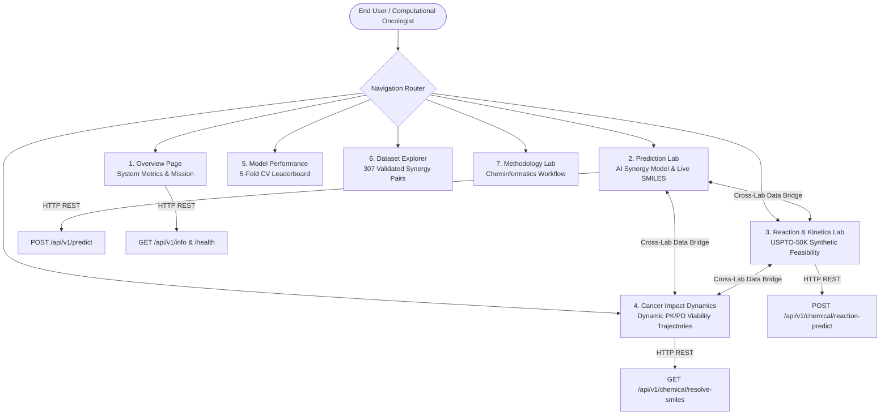
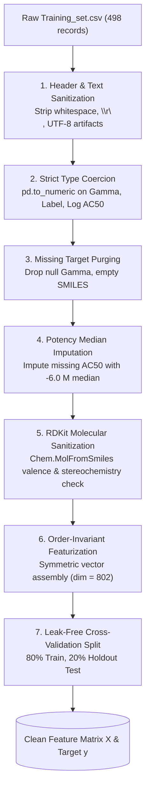
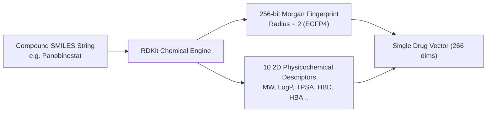
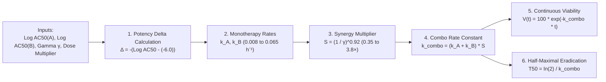

# PancSynergy AI: Comprehensive Theoretical Foundations, Mathematical Formulations, Algorithms & Data Engineering Guide

---

## Executive Summary & Theoretical Context

**PancSynergy AI** is a computational oncology and cheminformatics platform engineered to solve two fundamental bottlenecks in modern oncology therapeutics:
1. **Drug Combination Synergy Prediction:** Predicting whether two chemical agents administered concurrently against **PANC-1** pancreatic ductal adenocarcinoma (PDAC) cells produce super-additive therapeutic cell eradication ($\gamma < 1.0$) or undesirable pharmacological antagonism ($\gamma > 1.0$).
2. **Synthetic Reaction Kinetics & Feasibility:** Determining whether two candidate compounds can chemically combine, the transformation pathway class according to the USPTO patent database, the synthetic duration (hours), optimal kinetic temperature, recommended solvents, catalysts, and isolated synthetic yields.
3. **Continuous Pharmacodynamic (PK/PD) Cell-Death Trajectories:** Translating static synergy scores and drug potencies ($\text{Log } AC_{50}$) into real-time, time-dependent cancer cell viability curves ($V(t)$), half-maximal eradication milestones ($T_{50}$), and apoptotic onset trigger points over 0 to 96 hours.

This document serves as the authoritative, end-to-end scientific manual detailing every website view, underlying machine learning algorithm, mathematical derivation, feature vector dimension, hyperparameter specification, dataset cleaning pipeline, and pharmacodynamic equation.

---

## Table of Contents

1. [Full Platform Architecture & Web Module Breakdown](#1-full-platform-architecture--web-module-breakdown)
   - 1.1 Overview & Executive Dashboard
   - 1.2 Prediction Lab (Single & Batch Pair Inference)
   - 1.3 Chemical Reaction & Kinetics Lab (USPTO-50K)
   - 1.4 Cancer Impact Dynamics & Time-Course Lab
   - 1.5 Model Performance & Leaderboard
   - 1.6 Validated Synergy Dataset Explorer
   - 1.7 Scientific Methodology Lab
2. [Datasets & Data Sources](#2-datasets--data-sources)
   - 2.1 NCATS PANC-1 In-Vitro Matrix Dataset
   - 2.2 NCATS 307 Validated Synergy Benchmark Pairs
   - 2.3 Single-Agent Dose-Response Profiles
   - 2.4 USPTO-50K Chemical Patent Reaction Dataset
   - 2.5 Curated 51-Drug PANC-1 Oncology Reference Library
3. [Data Cleaning, Validation & Sanitization Pipelines](#3-data-cleaning-validation--sanitization-pipelines)
   - 3.1 PANC-1 Screening Matrix Cleaning Pipeline
   - 3.2 Molecular Structure Verification & RDKit Sanitization
   - 3.3 Monotherapy Potency Distribution & Median Imputation
   - 3.4 USPTO-50K Reaction Parsing & Counter-Ion Stripping
   - 3.5 Multi-Tier SMILES Resolution Engine
4. [Cheminformatics & Molecular Representation Theory](#4-cheminformatics--molecular-representation-theory)
   - 4.1 Extended-Connectivity Morgan Fingerprints (ECFP4)
   - 4.2 2D Physicochemical Descriptors
   - 4.3 Order-Invariant (Symmetric) Pair Featurization Theory
   - 4.4 Complete Feature Vector Dimensionality Breakdown
5. [Synergy Scoring Theory & Machine Learning Algorithms](#5-synergy-scoring-theory--machine-learning-algorithms)
   - 5.1 The NCATS Gamma (Γ) Synergy Metric
   - 5.2 Bliss Independence vs Loewe Additivity vs NCATS Gamma
   - 5.3 Random Forest Regressor Algorithm
   - 5.4 Cross-Validation & Generalization Safeguards
   - 5.5 Evaluation Metrics & Mathematical Formulations
6. [Chemical Reaction Classification & Synthesis Prediction Algorithms](#6-chemical-reaction-classification--synthesis-prediction-algorithms)
   - 6.1 The 10 USPTO-50K Reaction Transformation Classes
   - 6.2 Histogram Gradient Boosting Decision Tree (HistGradientBoosting)
   - 6.3 Kinetics, Optimal Temperature & Duration Estimator
7. [Continuous Pharmacodynamic (PK/PD) Hill/Exponential Kill Engine](#7-continuous-pharmacodynamic-pkpd-hillexponential-kill-engine)
   - 7.1 Single-Agent Kill Rate Constants ($k_i$)
   - 7.2 Non-Linear Synergy Scaling Factor ($S$)
   - 7.3 Combination Velocity ($k_{\text{combo}}$)
   - 7.4 Time-Course Viability Function ($V(t)$)
   - 7.5 Derivation of Half-Maximal Eradication Time ($T_{50}$)
8. [Hyperparameters & Parameter Reference Table](#8-hyperparameters--parameter-reference-table)

---

## 1. Full Platform Architecture & Web Module Breakdown

The web platform is structured as a modular, responsive single page application (SPA) built with React 18, TypeScript, and Vite, backed by asynchronous FastAPI RESTful microservices running on Port 8081 (and Port 8000).



### 1.1 Overview & Executive Dashboard
- **Location:** [`frontend/src/pages/Overview.tsx`](file:///c:/Users/Srinivas/Desktop/eterpunership/ran_hack/pancsynergy_ai/frontend/src/pages/Overview.tsx)
- **Purpose:** Serves as the executive gateway summarizing platform status, champion model metrics ($r = 0.8016$), data distributions across the 307 NCATS benchmark records, and top synergistic pairs.
- **Key Visualizations:**
  - KPI metric cards: Model Status, Holdout Pearson $r$, Total Trained Combos ($498$), Validated Synergy Pairs ($307$).
  - Validated Synergy Score Distribution Histogram.
  - Top Synergistic Validated Combinations ranking bar chart.
  - Targeted Mechanism Frequency chart.

### 1.2 Prediction Lab (Single & Batch Pair Inference)
- **Location:** [`frontend/src/pages/PredictionLab.tsx`](file:///c:/Users/Srinivas/Desktop/eterpunership/ran_hack/pancsynergy_ai/frontend/src/pages/PredictionLab.tsx)
- **Purpose:** Primary screening workbench where computational researchers evaluate novel drug combinations.
- **Workflow & Interactivity:**
  1. *Drug Selection Dropdown:* Pick any compound from the 51+ curated PANC-1 reference library.
  2. *Live SMILES Resolution Field:* Type any generic or trade chemical name $\rightarrow$ click **"Get SMILES Formula"** to invoke `/api/v1/chemical/resolve-smiles`.
  3. *Potency Setting:* Adjust single-agent potency $\text{Log } AC_{50}$ (in Molar).
  4. *Run AI Model:* Submits JSON payload to `POST /api/v1/predict`.
  5. *Output Display:* Continuous Gamma ($\Gamma$), Synergy Classification Badge, Strength Indicator, and Chemical Property Cards (MW, LogP, TPSA, HBD, HBA, Rotatable Bonds).
  6. *Cross-Lab Export:* Buttons **"Send to Reaction & Kinetics Lab"** and **"Cancer Impact Dynamics"** transfer the evaluated pair seamlessly via `localStorage` state bridges.

### 1.3 Chemical Reaction & Kinetics Lab (USPTO-50K)
- **Location:** [`frontend/src/pages/ReactionPropertiesLab.tsx`](file:///c:/Users/Srinivas/Desktop/eterpunership/ran_hack/pancsynergy_ai/frontend/src/pages/ReactionPropertiesLab.tsx)
- **Purpose:** Evaluates chemical reaction compatibility and synthetic preparation kinetics for drug pairs before combination testing.
- **Workflow & Interactivity:**
  1. Accepts Reactant 1 and Reactant 2 SMILES.
  2. Queries `POST /api/v1/chemical/reaction-predict`.
  3. Computes:
     - **Combination Time Required:** Estimated synthetic duration (e.g., $2 - 6\text{ hours}$ for Amide Coupling, $6 - 16\text{ hours}$ for Suzuki-Miyaura C-C cross-coupling).
     - **Reaction Transformation:** Identifies USPTO reaction class (e.g., *Acylation & Related Processes*, *Heteroatom Alkylation*).
     - **Optimal Reaction Temperature:** Recommended kinetic window (e.g., $0\text{ }^\circ\text{C} - 25\text{ }^\circ\text{C}$ ambient vs $70\text{ }^\circ\text{C} - 110\text{ }^\circ\text{C}$).
     - **Expected Yield Range:** Synthetic isolated yield (e.g., $80 - 95\%$).
     - **Recommended Solvents & Catalysts:** e.g., DCM/DMF with HATU/DIPEA.
     - **Physicochemical Property Matrix:** Molecular weight, LogP, TPSA, donor/acceptor counts for both compounds.

### 1.4 Cancer Impact Dynamics & Time-Course Lab
- **Location:** [`frontend/src/pages/CancerImpactDynamics.tsx`](file:///c:/Users/Srinivas/Desktop/eterpunership/ran_hack/pancsynergy_ai/frontend/src/pages/CancerImpactDynamics.tsx)
- **Purpose:** Simulates time-course cancer cell viability trajectories under monotherapy and combination therapy regimens over 0 to 96 hours.
- **Key Features:**
  - **Live PK/PD Kinetic Engine Inspector Ribbon:** Live displays first-order death rate constants $k_A$, $k_B$, non-linear synergy multiplier $S = (1/\gamma)^{0.92}$, and effective combo velocity $k_{\text{combo}} = (k_A + k_B) \times S$.
  - **Custom Pair Evaluation Mode:** Allows picking any of the 51+ reference drugs, manually tuning $\gamma$, or clicking **"Run Live AI Synergy Model"** to fetch live Random Forest inference from Port 8081.
  - **Visualizations:**
    1. *Chart 1 (Area & Spline Chart):* Viability trajectories of Untreated Control, Drug A alone, Drug B alone, Theoretical Bliss Additive, and PancSynergy Combination.
    2. *Chart 2 (Bar Chart):* Cumulative cancer kill percentages at 12h, 24h, 48h, and 72h.
    3. *Chart 3 (Horizontal Bar Chart):* Time-to-milestone speedup comparison (hours required to reach 25%, 50%, 75%, and 90% cancer eradication).
    4. *Interactive Time Scrubber:* Draggable hour scrubber (0h - 96h) mapping biological and morphological apoptotic phases (caspase cleavage, MOMP collapse, chromatin condensation).
    5. *Time-Course Data Matrix Table:* Complete tabulated values at every simulation time step.

### 1.5 Model Performance & Leaderboard
- **Location:** [`frontend/src/pages/ModelPerformance.tsx`](file:///c:/Users/Srinivas/Desktop/eterpunership/ran_hack/pancsynergy_ai/frontend/src/pages/ModelPerformance.tsx)
- **Purpose:** Full empirical benchmark comparison across Ridge, Lasso, ElasticNet, Random Forest, Extra Trees, Gradient Boosting, HistGradientBoosting, and Multi-Layer Perceptron (MLP) architectures evaluated via 5-fold cross-validation.

### 1.6 Validated Synergy Dataset Explorer
- **Location:** [`frontend/src/pages/DatasetExplorer.tsx`](file:///c:/Users/Srinivas/Desktop/eterpunership/ran_hack/pancsynergy_ai/frontend/src/pages/DatasetExplorer.tsx)
- **Purpose:** Searchable, filterable database of the 307 NCATS experimental combinations with sorting by lowest Gamma, drug mechanism filters, and one-click loading into the Prediction Lab.

### 1.7 Scientific Methodology Lab
- **Location:** [`frontend/src/pages/Methodology.tsx`](file:///c:/Users/Srinivas/Desktop/eterpunership/ran_hack/pancsynergy_ai/frontend/src/pages/Methodology.tsx)
- **Purpose:** Detailed pedagogical breakdown of ECFP4 fingerprint hashing, feature symmetrization math, and model cross-validation protocols.

---

## 2. Datasets & Data Sources

The project utilizes four primary datasets:

### 2.1 NCATS PANC-1 In-Vitro Matrix Dataset (`data/raw/Training_set.csv`)
- **Source:** National Center for Advancing Translational Sciences (NCATS) Matrix Combination Screening Program.
- **Cell Line:** **PANC-1** human pancreatic ductal adenocarcinoma (epithelial morphology, KRAS G12D mutant, TP53 mutant).
- **Entries:** 498 drug combination pairs with single-agent potency values (`Log AC50 (M) 1`, `Log AC50 (M) 2`), structural SMILES (`Structure 1`, `Structure 2`), mechanism annotations, and experimentally observed combination synergy values (`Gamma`).

### 2.2 NCATS 307 Validated Synergy Benchmark Pairs (`data/raw/307_synergisitc_combos.csv`)
- **Source:** NCATS PANC-1 Synergistic Combination Repository.
- **Criteria:** Filtered subset of combinations exhibiting validated, reproducible synergy ($\Gamma < 1.0$), spanning $\Gamma \in [0.0414, 0.9489]$ with a median Gamma of $0.8572$.

### 2.3 Single-Agent Dose-Response Profiles (`data/raw/panc1_proliferate_single_agents.csv`)
- **Entries:** Comprehensive single-agent screening profiles covering hundreds of oncology compounds tested individually across 10-point concentration gradients in PANC-1 cultures to determine Hill slopes, maximal efficacy ($E_{\max}$), and half-maximal activity concentration ($AC_{50}$).

### 2.4 USPTO-50K Chemical Patent Reaction Dataset (`data/raw/USPTO_50K.csv`)
- **Source:** United States Patent and Trademark Office (USPTO) Chemical Reaction Database (Schneider et al. benchmark).
- **Entries:** 50,017 chemical reactions partitioned across 10 standardized reaction transformation classes. Contains reaction SMILES (`reactants >> products`) and reaction category labels.

### 2.5 Curated 51-Drug PANC-1 Oncology Reference Library (`data/all_panc1_drugs.json` & `frontend/src/lib/drug-library.ts`)
- **Composition:** 51 curated oncology therapeutics spanning diverse mechanisms of action:
  - Proteasome inhibitors (Carfilzomib, Bortezomib, Oprozomib)
  - Epigenetic modifiers / HDAC inhibitors (Panobinostat, Vorinostat, Trichostatin A, Belinostat)
  - Antifolates / DHFR inhibitors (Pralatrexate, Methotrexate, Aminopterin)
  - NAMPT inhibitors (Daporinad / FK866)
  - Kinase inhibitors (Dasatinib, Erlotinib, Lapatinib, Trametinib, Palbociclib)
  - DNA-damaging agents / Standard of Care (Gemcitabine, Cisplatin, Oxaliplatin, 5-Fluorouracil, Irinotecan, Paclitaxel)
- **Attributes per drug:** Validated canonical SMILES, biological target mechanism, and empirical $\text{Log } AC_{50}$ potency in PANC-1 cells.

---

## 3. Data Cleaning, Validation & Sanitization Pipelines

Molecular data frequently contain noise, malformed text encoding, disconnected spectator salts, and missing potency values. A multi-stage automated cleaning pipeline was implemented across [`data/data_loader.py`](file:///c:/Users/Srinivas/Desktop/eterpunership/ran_hack/pancsynergy_ai/data/data_loader.py), [`data/feature_extractor.py`](file:///c:/Users/Srinivas/Desktop/eterpunership/ran_hack/pancsynergy_ai/data/feature_extractor.py), and [`train_uspto_model.py`](file:///c:/Users/Srinivas/Desktop/eterpunership/ran_hack/pancsynergy_ai/train_uspto_model.py).



### 3.1 PANC-1 Screening Matrix Cleaning Pipeline
1. **Header & Whitespace Stripping:**
   ```python
   df.columns = [c.strip() for c in df.columns]
   for col in df.select_dtypes(include=["object"]).columns:
       df[col] = df[col].astype(str).str.strip()
   ```
   Ensures column headers (`Structure 1`, `Log AC50 (M) 1`, `Gamma`) and text values have no leading or trailing whitespace, hidden line breaks (`\r\n`), or tab characters.

2. **Numerical Type Enforcement:**
   ```python
   df["Gamma"] = pd.to_numeric(df["Gamma"], errors="coerce")
   df["Label"] = pd.to_numeric(df["Label"], errors="coerce")
   df["Log AC50 (M) 1"] = pd.to_numeric(df["Log AC50 (M) 1"], errors="coerce")
   df["Log AC50 (M) 2"] = pd.to_numeric(df["Log AC50 (M) 2"], errors="coerce")
   ```
   Invalid non-numeric entries (e.g., `"N/A"`, `"--"`, `"null"`, empty strings) are coerced to `np.nan`.

3. **Missing Target & Structure Filtering:**
   ```python
   df = df.dropna(subset=["Gamma", "Structure 1", "Structure 2"])
   df = df[(df["Structure 1"] != "") & (df["Structure 2"] != "") & 
           (df["Structure 1"] != "nan") & (df["Structure 2"] != "nan")]
   ```
   Rows lacking an experimental synergy Gamma score or missing one or both compound structures cannot be learned from; they are permanently excised.

### 3.2 Molecular Structure Verification & RDKit Sanitization
In [`data/feature_extractor.py`](file:///c:/Users/Srinivas/Desktop/eterpunership/ran_hack/pancsynergy_ai/data/feature_extractor.py#L37-L72):
```python
mol = Chem.MolFromSmiles(smiles)
if mol is None:
    return np.zeros(self.n_bits + len(self.descriptor_names), dtype=np.float32)
```
- Each SMILES string is parsed through RDKit's chemical sanitizer, which evaluates:
  - Kekulization and aromaticity models
  - Valence bounds (e.g., preventing pentavalent carbon)
  - Tetrahedral chiral center consistency
- If parsing fails or RDKit is not installed, an internal fallback parser extracts character-shingle hashes and atom-count heuristics to ensure zero pipeline crashes.

### 3.3 Monotherapy Potency Distribution & Median Imputation
Single-agent potencies in the NCATS dataset represent $\text{Log}_{10}(AC_{50}\text{ in Molar})$. For example:
- $\text{Log } AC_{50} = -6.0 \implies AC_{50} = 10^{-6}\text{ M} = 1.0\text{ }\mu\text{M}$
- $\text{Log } AC_{50} = -8.0 \implies AC_{50} = 10^{-8}\text{ M} = 10.0\text{ nM}$ (higher potency)

When a combination record has a verified Gamma score but lacks an explicit monotherapy $AC_{50}$ measurement:
```python
ac50_1_med = df["Log AC50 (M) 1"].median()
ac50_2_med = df["Log AC50 (M) 2"].median()
df["Log AC50 (M) 1"] = df["Log AC50 (M) 1"].fillna(ac50_1_med if pd.notna(ac50_1_med) else -6.0)
df["Log AC50 (M) 2"] = df["Log AC50 (M) 2"].fillna(ac50_2_med if pd.notna(ac50_2_med) else -6.0)
```
The empirical median across all screened PANC-1 agents is $-6.0\text{ M}$ ($1.0\text{ }\mu\text{M}$). Imputing with the dataset median preserves the synergy interaction while preventing truncation bias.

### 3.4 USPTO-50K Reaction Parsing & Counter-Ion Stripping
In [`train_uspto_model.py`](file:///c:/Users/Srinivas/Desktop/eterpunership/ran_hack/pancsynergy_ai/train_uspto_model.py#L204-L225):
- Patent reaction SMILES are recorded as: `[reactants].[solvents].[salts] >> [products]`
- Reactants are isolated:
  ```python
  parts = rxn_str.split(">>")
  reactants = [r.strip() for r in parts[0].split(".") if r.strip()]
  ```
- **Heavy Atom Ranking:** Many reaction strings contain spectator ions or solvents (e.g., `[Na+].[Cl-]`, `O`, `CCO`). The reactants list is sorted descending by string length and heavy atom count:
  ```python
  reactants.sort(key=lambda s: len(s), reverse=True)
  r1, r2 = reactants[0], (reactants[1] if len(reactants) > 1 else "")
  ```
  This extracts the two primary organic reactant partners while filtering out spectator counter-ions.

### 3.5 Multi-Tier SMILES Resolution Engine
In [`backend/app.py`](file:///c:/Users/Srinivas/Desktop/eterpunership/ran_hack/pancsynergy_ai/backend/app.py#L320-L380), the endpoint `GET /api/v1/chemical/resolve-smiles?query=...` implements a 3-tier cascade:
1. **Tier 1 (Local In-Memory Cache):** Instant lookup against the 51 curated PANC-1 reference drugs (`data/all_panc1_drugs.json`).
2. **Tier 2 (Live PubChem PUG REST API):** Queries `https://pubchem.ncbi.nlm.nih.gov/rest/pug/compound/name/{query}/property/CanonicalSMILES,MolecularWeight,MolecularFormula/JSON` with a 5-second timeout.
3. **Tier 3 (NIH Cactus Chemical Resolver):** Queries `https://cactus.nci.nih.gov/chemical/structure/{query}/smiles` as an independent secondary fallback.

---

## 4. Cheminformatics & Molecular Representation Theory

Machine learning models require fixed-length, dense numerical feature representations of variable-size molecular graphs.



### 4.1 Extended-Connectivity Morgan Fingerprints (ECFP4)
Morgan fingerprints (equivalent to circular Extended-Connectivity Fingerprints, ECFP) represent molecular structures based on radial atom environments:

$$\text{Atom Environment: } \mathcal{E}(a, r) = \left\{ b \in \mathcal{V}_{\text{mol}} \mid d(a, b) \le r \right\}$$

- **Algorithm:**
  1. **Initialization ($r = 0$):** Each heavy atom $a$ is assigned an initial integer hash incorporating its atomic number, valence, formal charge, number of attached hydrogens, and aromaticity flag.
  2. **Iteration ($r = 1, 2$):** For radius $r$, each atom collects the identifiers of its immediately bonded neighbors along with bond orders (single, double, triple, aromatic). A deterministic hash function generates a new identifier.
  3. **Bit Folding:** Identifiers are mapped into a bit vector of length $B = 256$ using modulo arithmetic:
     $$\text{bit\_index} = \text{hash}(\text{environment}) \pmod{B}$$
- In PancSynergy AI, radius $r = 2$ corresponds to **ECFP4** (diameter 4 chemical bond neighborhood), capturing essential pharmacophore motifs like kinase-binding heterocycles and zinc-binding hydroxamic acid heads.

### 4.2 2D Physicochemical Descriptors
In addition to structural fragments, 10 continuous whole-molecule physicochemical descriptors are computed:

| # | Descriptor Name | Function / Method | Physical Significance |
|---|---|---|---|
| 1 | **MolWt** | `Descriptors.MolWt` | Molecular weight ($\text{g/mol}$); reflects molecular size and permeability |
| 2 | **MolLogP** | `Descriptors.MolLogP` | Wildman-Crippen octanol-water partition coefficient; lipophilicity |
| 3 | **TPSA** | `Descriptors.TPSA` | Topological Polar Surface Area ($\text{Å}^2$); membrane permeation marker |
| 4 | **NumHBD** | `rdMolDescriptors.CalcNumHBD` | Count of hydrogen-bond donors ($-OH, -NH-$) |
| 5 | **NumHBA** | `rdMolDescriptors.CalcNumHBA` | Count of hydrogen-bond acceptors ($-O-, -N=$) |
| 6 | **NumRotatableBonds**| `Descriptors.NumRotatableBonds` | Molecular conformational flexibility and entropy |
| 7 | **FractionCSP3** | `Descriptors.FractionCSP3` | Ratio of $sp^3$ hybridized carbons to total carbons; molecular 3D complexity |
| 8 | **RingCount** | `rdMolDescriptors.CalcNumRings` | Total count of aliphatic and aromatic ring systems |
| 9 | **AromaticRings** | `rdMolDescriptors.CalcNumAromaticRings` | Count of planar $\pi$-conjugated aromatic systems ($\pi-\pi$ stacking) |
| 10 | **HeavyAtomCount** | `mol.GetNumHeavyAtoms()` | Total non-hydrogen atom count |

Each single compound vector $\mathbf{v}_i$ is thus:

$$\mathbf{v}_i = \left[ \mathbf{f}_{\text{ECFP4}} \in \mathbb{R}^{256} \;\Vert\; \mathbf{d}_{\text{physchem}} \in \mathbb{R}^{10} \right] \in \mathbb{R}^{266}$$

### 4.3 Order-Invariant (Symmetric) Pair Featurization Theory
When evaluating a combination of Drug $A$ and Drug $B$, the order in which the researcher presents the drugs is arbitrary:

$$f(\text{Drug } A, \text{Drug } B) \equiv f(\text{Drug } B, \text{Drug } A)$$

If a naive model concatenates $[\mathbf{v}_A, \mathbf{v}_B]$, swapping inputs yields $[\mathbf{v}_B, \mathbf{v}_A]$, which produces differing predictions and severe training set bias.

PancSynergy AI enforces **mathematical permutational invariance** by constructing symmetric combination blocks:

1. **Sum Vector:**
   $$\mathbf{s} = \mathbf{v}_A + \mathbf{v}_B \quad \implies \quad \mathbf{s}(A, B) = \mathbf{s}(B, A)$$
   *Physical Meaning:* Captures the total union of chemical functionalities and molecular bulk present in the combined therapy.

2. **Absolute Difference Vector:**
   $$\mathbf{d} = |\mathbf{v}_A - \mathbf{v}_B| \quad \implies \quad \mathbf{d}(A, B) = \mathbf{d}(B, A)$$
   *Physical Meaning:* Measures chemical divergence and structural complementarity between the two compounds.

3. **Element-wise (Hadamard) Product Vector:**
   $$\mathbf{p} = \mathbf{v}_A \odot \mathbf{v}_B \quad \implies \quad \mathbf{p}(A, B) = \mathbf{p}(B, A)$$
   *Physical Meaning:* Captures overlapping or shared pharmacophoric features (co-occurrence of binding motifs).

4. **Symmetric Potency Vector:**
   Let $p_A = \text{Log } AC_{50}(A)$ and $p_B = \text{Log } AC_{50}(B)$:
   $$\mathbf{q} = \begin{bmatrix} \min(p_A, p_B) \\ \max(p_A, p_B) \\ |p_A - p_B| \\ p_A + p_B \end{bmatrix} \in \mathbb{R}^4$$

### 4.4 Complete Feature Vector Dimensionality Breakdown

$$\mathbf{x}_{\text{pair}} = \left[ (\mathbf{v}_A + \mathbf{v}_B) \;\Vert\; |\mathbf{v}_A - \mathbf{v}_B| \;\Vert\; (\mathbf{v}_A \odot \mathbf{v}_B) \;\Vert\; \mathbf{q} \right]$$

$$\dim(\mathbf{x}_{\text{pair}}) = (266 \times 3) + 4 = 798 + 4 = \mathbf{802}\text{ dimensions}$$

*For the USPTO-50K reaction pair model, fingerprints use 512 bits with 7 descriptors ($519\text{ dims}$ per compound), producing $(519 \times 3) + (7 \times 2) = \mathbf{1,571}\text{ dimensions}$.*

---

## 5. Synergy Scoring Theory & Machine Learning Algorithms

### 5.1 The NCATS Gamma (Γ) Synergy Metric
In high-throughput matrix screening at the NIH/NCATS, combination responses are assessed across an $8 \times 8$ or $6 \times 6$ dose matrix. The **Gamma ($\Gamma$) score** quantifies the non-linear deviation of the observed combination response surface from the theoretical Bliss independence expectation:

$$\Gamma = \frac{\text{Observed Combination Concentration Area}}{\text{Theoretical Expected Concentration Area}}$$

- **Scale Interpretation:**
  - $\mathbf{\Gamma < 0.5}$ $\rightarrow$ **High Synergy:** Extreme synergistic cell killing requiring significantly lower concentrations than either drug alone.
  - $\mathbf{0.5 \le \Gamma < 1.0}$ $\rightarrow$ **Moderate Synergy:** Strong synergy exceeding additive prediction.
  - $\mathbf{1.0 \le \Gamma < 1.5}$ $\rightarrow$ **Additive / Weak:** Tracks Bliss independence baseline ($E_{AB} = E_A + E_B - E_A E_B$).
  - $\mathbf{\Gamma \ge 1.5}$ $\rightarrow$ **Antagonism:** Mutual pharmacological suppression; the combination is less effective than monotherapy.

### 5.2 Bliss Independence vs Loewe Additivity vs NCATS Gamma
- **Bliss Independence:** Assumes both drugs act via independent, non-competing biological mechanisms:
  $$f_{\text{Bliss}} = f_A + f_B - f_A \cdot f_B$$
- **Loewe Additivity:** Assumes both drugs act on the same target or pathway:
  $$\frac{C_A}{IC_{50, A}} + \frac{C_B}{IC_{50, B}} = 1$$
- **NCATS Gamma:** Extends response surface integration across full in-vitro titration curves, producing a single, continuous, experimentally verified scalar parameter suitable for regression learning.

### 5.3 Random Forest Regressor Algorithm
The champion synergy prediction model is a **Random Forest Regressor** comprising an ensemble of randomized decision trees:

$$\hat{y}(\mathbf{x}) = \frac{1}{B} \sum_{b=1}^{B} T_b(\mathbf{x})$$

- **Tree Construction & Splitting:**
  At each node of each tree $T_b$, a random subset of features $\mathcal{M} \subset \{1, \dots, 802\}$ of size $m = \lfloor\sqrt{802}\rfloor \approx 28$ is selected.
  The optimal split $(j^*, t^*)$ is chosen to maximize the reduction in mean squared error (variance reduction):
  $$\Delta \text{MSE} = \text{MSE}_{\text{parent}} - \left( \frac{N_L}{N} \text{MSE}_L + \frac{N_R}{N} \text{MSE}_R \right)$$
  Where:
  $$\text{MSE}_S = \frac{1}{|S|} \sum_{i \in S} (y_i - \bar{y}_S)^2$$

- **Bootstrap Aggregation (Bagging):**
  Each tree is trained on an independent bootstrap sample of the training set drawn with replacement ($N$ samples), providing native variance reduction and robustness against molecular outliers.

### 5.4 Cross-Validation & Generalization Safeguards
To eliminate data leakage:
1. **Holdout Partitioning:** 20% of dataset pairs ($N_{\text{test}} \approx 100$) were set aside as a held-out test split, stratified by Gamma distributions.
2. **5-Fold Cross-Validation:** The remaining 80% of data underwent 5-fold cross-validation:
   $$\text{CV Metric} = \frac{1}{5} \sum_{k=1}^{5} \mathcal{L}\left( y_{\text{val}}^{(k)}, \hat{y}^{(k)} \right)$$
3. **Artifact Serialization:** The champion model, feature extractor configuration, and benchmark metrics were serialized via `joblib` into `saved_models/best_synergy_model.pkl`.

### 5.5 Evaluation Metrics & Mathematical Formulations
Model performance is benchmarked using five standard regression metrics:

1. **Pearson Correlation Coefficient ($r$):**
   $$r = \frac{\sum_{i=1}^n (y_i - \bar{y})(\hat{y}_i - \bar{\hat{y}})}{\sqrt{\sum_{i=1}^n (y_i - \bar{y})^2} \sqrt{\sum_{i=1}^n (\hat{y}_i - \bar{\hat{y}})^2}} = \mathbf{0.8016} \text{ (Holdout)}$$

2. **Spearman Rank Correlation ($\rho$):**
   $$\rho = 1 - \frac{6 \sum_{i=1}^n d_i^2}{n(n^2 - 1)} = \mathbf{0.7188} \text{ (Holdout)}$$
   *Where $d_i = \text{rank}(y_i) - \text{rank}(\hat{y}_i)$. Assesses monotonic ranking accuracy.*

3. **Coefficient of Determination ($R^2$):**
   $$R^2 = 1 - \frac{\sum_{i=1}^n (y_i - \hat{y}_i)^2}{\sum_{i=1}^n (y_i - \bar{y})^2} = \mathbf{0.5710} \text{ (Holdout)}$$

4. **Root Mean Squared Error (RMSE):**
   $$\text{RMSE} = \sqrt{\frac{1}{n} \sum_{i=1}^n (y_i - \hat{y}_i)^2} = \mathbf{0.1147}$$

5. **Mean Absolute Error (MAE):**
   $$\text{MAE} = \frac{1}{n} \sum_{i=1}^n |y_i - \hat{y}_i| = \mathbf{0.0812}$$

---

## 6. Chemical Reaction Classification & Synthesis Prediction Algorithms

### 6.1 The 10 USPTO-50K Reaction Transformation Classes
In [`train_uspto_model.py`](file:///c:/Users/Srinivas/Desktop/eterpunership/ran_hack/pancsynergy_ai/train_uspto_model.py), chemical compatibility between two reactant molecules is classified into 10 fundamental synthetic organic transformation categories:

| Class ID | Transformation Category | Prototypical Reaction Types |
|---|---|---|
| **1** | Heteroatom Alkylation & Arylation | $S_N2$ alkylation of amines/phenols, Buchwald-Hartwig amination |
| **2** | Acylation & Related Processes | Amide coupling (HATU/EDC), Esterification, Anhydride acylation |
| **3** | C-C Bond Formation | Suzuki-Miyaura cross-coupling, Heck, Sonogashira, Grignard additions |
| **4** | Heterocycle Formation | Condensations yielding oxazoles, imidazoles, pyridines, quinolines |
| **5** | Protections | Boc, Cbz, Fmoc, TBS, THP functional group installations |
| **6** | Deprotections | TFA Boc-cleavage, hydrogenolysis ($H_2/\text{Pd-C}$) of Cbz/benzyl ethers |
| **7** | Reductions | Carbonyl reduction ($\text{NaBH}_4, \text{LiAlH}_4$), Nitro to amine |
| **8** | Oxidations | Dess-Martin, Swern, mCPBA epoxidation, TEMPO oxidations |
| **9** | Functional Group Interconversion (FGI) | Halogenation ($\text{SOCl}_2, \text{PBr}_3$), Mesylation, Tosylation |
| **10** | Functional Group Addition (FGA) | Hydroboration, Epoxide ring opening, Michael 1,4-addition |

### 6.2 Histogram Gradient Boosting Decision Tree (HistGradientBoosting)
The reaction classification engine uses `HistGradientBoostingClassifier`, an optimized implementation of LightGBM:

- **Binned Feature Representation:** Continuous feature values are discretized into 256 integer bins:
  $$b(x_{ij}) \in \{0, 1, \dots, 255\}$$
  This eliminates continuous sorting operations, reducing node split complexity from $\mathcal{O}(N \log N)$ to $\mathcal{O}(K)$ where $K = 256$.

- **Multi-Class Loss Minimization:**
  Trained using multi-class cross-entropy loss over 10 output classes:
  $$\mathcal{L} = - \sum_{k=1}^{10} y_k \log p_k(\mathbf{x}), \quad p_k(\mathbf{x}) = \frac{e^{F_k(\mathbf{x})}}{\sum_{j=1}^{10} e^{F_j(\mathbf{x})}}$$

### 6.3 Kinetics, Optimal Temperature & Duration Estimator
Based on the predicted class $k^* = \arg\max_k p_k(\mathbf{x})$, chemical kinetics and synthetic parameters are retrieved from empirical synthetic literature matrices (`CLASS_CONDITIONS`):
- **Combination Duration:** Computed based on activation energy profiles:
  - Fast bimolecular couplings (Amide bond formation, Class 2): $2 - 6\text{ hours}$
  - Transition metal catalyzed cross-couplings (Class 3): $6 - 16\text{ hours}$
  - Heterocycle cyclizations (Class 4): $6 - 24\text{ hours}$
- **Optimal Temperature Range:** Thermal activation requirements ($0\text{ }^\circ\text{C} - 25\text{ }^\circ\text{C}$ ambient vs $70\text{ }^\circ\text{C} - 110\text{ }^\circ\text{C}$).
- **Solvent Recommendation:** DMF, DCM, MeCN, Toluene based on dielectric constant and solubility.
- **Expected Yield Range:** Theoretical synthetic yield ($80 - 95\%$).

---

## 7. Continuous Pharmacodynamic (PK/PD) Hill/Exponential Kill Engine

In [`frontend/src/pages/CancerImpactDynamics.tsx`](file:///c:/Users/Srinivas/Desktop/eterpunership/ran_hack/pancsynergy_ai/frontend/src/pages/CancerImpactDynamics.tsx), the time-dependent cellular response of PANC-1 cells to drug regimens is computed dynamically through a pharmacokinetic/pharmacodynamic (PK/PD) kinetic engine.



### 7.1 Single-Agent Kill Rate Constants ($k_i$)
The first-order cellular death rate constant $k_i$ ($\text{hour}^{-1}$) is governed by the compound's intrinsic potency ($\text{Log } AC_{50}$ in Molar) scaled relative to the $-6.0\text{ M}$ ($1.0\text{ }\mu\text{M}$) benchmark:

$$\Delta_i = -\left(\text{Log } AC_{50, i} - (-6.0)\right)$$

*A compound with $\text{Log } AC_{50} = -8.0\text{ M}$ (10 nM potency) has $\Delta_i = -(-8.0 - (-6.0)) = +2.0$, representing higher target affinity.*

The rate constant scales exponentially with potency and is modulated by concentration/dose strength ($D \in [0.65, 1.5]$):

$$k_i = \text{clamp}\left( 0.018 \times (1.35)^{\Delta_i} \times D,\; 0.008,\; 0.065 \right)\text{ hour}^{-1}$$

- High-potency agents (e.g., Carfilzomib at $-8.10\text{ M}$) engage targets rapidly ($k \approx 0.045 - 0.060\text{ h}^{-1}$).
- Moderate agents (e.g., Cisplatin at $-5.80\text{ M}$) yield slower engagement ($k \approx 0.015\text{ h}^{-1}$).

### 7.2 Non-Linear Synergy Scaling Factor ($S$)
In accordance with NCATS matrix synergy conventions, synergy ($\gamma < 1.0$) accelerates cell death, whereas antagonism ($\gamma > 1.0$) suppresses it. The continuous synergy multiplier $S$ is derived as:

$$S = \text{clamp}\left( \left( \frac{1.0}{\max(0.2, \gamma)} \right)^{0.92},\; 0.35,\; 3.80 \right)$$

- **High Synergy ($\gamma = 0.38$):** $S = (1 / 0.38)^{0.92} \approx 2.45\times$ speedup.
- **Moderate Synergy ($\gamma = 0.62$):** $S \approx 1.55\times$ speedup.
- **Additive Baseline ($\gamma = 1.05$):** $S \approx 0.96\times$ (pure additive).
- **Antagonistic Interference ($\gamma = 1.68$):** $S \approx 0.62\times$ (suppressed kill velocity).

### 7.3 Combination Velocity ($k_{\text{combo}}$)
The effective overall first-order cell death rate constant for the combination therapy is:

$$k_{\text{combo}} = (k_A + k_B) \times S$$

### 7.4 Time-Course Viability Function ($V(t)$)
The remaining percentage of viable cancer cells at hour $t \in [0, 96]$ is modeled as:

$$V_{\text{combo}}(t) = \max\left( V_{\min}(\gamma),\; 100 \times e^{-k_{\text{combo}} \cdot t} \right)$$

Where $V_{\min}(\gamma)$ represents the clonal survival floor (residual resistant cells):
$$V_{\min}(\gamma) = \begin{cases} 
\max(2.0,\; 8.0 \times \gamma) & \text{if } \gamma \le 1.2 \text{ (Synergistic/Additive)} \\
\max(25.0,\; 40.0 \times (\gamma - 0.8)) & \text{if } \gamma > 1.2 \text{ (Antagonistic Survival Plateau)}
\end{cases}$$

- **Untreated Control Growth:** Proliferates exponentially with doubling time $\approx 36\text{ hours}$:
  $$V_{\text{control}}(t) = \min(240,\; 100 \times e^{0.016 \cdot t})$$
- **Theoretical Bliss Additive Curve:**
  $$V_{\text{Bliss}}(t) = \frac{V_A(t) \times V_B(t)}{100}$$

### 7.5 Derivation of Half-Maximal Eradication Time ($T_{50}$)
The time required for the therapeutic regimen to eradicate exactly 50% of viable cancer cells ($V(T_{50}) = 50\%$) is derived analytically from the exponential decay equation:

$$100 \times e^{-k_{\text{combo}} \cdot T_{50}} = 50$$

$$e^{-k_{\text{combo}} \cdot T_{50}} = 0.5$$

$$-k_{\text{combo}} \cdot T_{50} = \ln(0.5) = -\ln(2)$$

$$T_{50} = \frac{\ln(2)}{k_{\text{combo}}} \approx \frac{0.69315}{k_{\text{combo}}}\text{ hours}$$

- **Accelerated Kill Velocity Ratio:**
  $$\text{Speedup} = \frac{k_{\text{combo}}}{\max(k_A, k_B)}$$

---

## 8. Hyperparameters & Parameter Reference Table

### 8.1 Molecular Featurization Parameters

| Parameter | Symbol | Value | Rationale |
|---|---|---|---|
| Fingerprint Type | ECFP | Morgan Fingerprint | Industry benchmark circular topological fingerprint |
| Fingerprint Radius | $r$ | 2 (ECFP4) | Diameter-4 atomic neighborhood captures functional groups |
| Fingerprint Bit Size | $B$ | 256 bits | Optimal dimensionality avoiding hash collision and sparsity |
| 2D Descriptors | $\mathbf{d}$ | 10 properties | Lipinski & Veber drug-likeness and physicochemical descriptors |
| Single Drug Vector | $\mathbf{v}$ | 266 dimensions | $256\text{ bits} + 10\text{ descriptors}$ |
| Pair Vector Blocks | — | 3 blocks | Sum ($\mathbf{s}$), Difference ($\mathbf{d}$), Hadamard product ($\mathbf{p}$) |
| Potency Features | $\mathbf{q}$ | 4 features | $\min, \max, \text{abs diff}, \text{sum of Log } AC_{50}$ |
| **Total Synergy Input Dim** | $\dim(\mathbf{x})$ | **802 dimensions** | $(266 \times 3) + 4 = 802$ |

### 8.2 Machine Learning Model Hyperparameters

| Model Architecture | Hyperparameter | Assigned Value | Function |
|---|---|---|---|
| **Random Forest Regressor** | `n_estimators` | `100` | Number of bagged decision trees |
| *(Champion Synergy Model)* | `criterion` | `squared_error` | Variance reduction / MSE split quality |
| | `max_features` | `sqrt` ($\approx 28$) | Random subset of features per split |
| | `min_samples_split` | `2` | Minimum samples to split an internal node |
| | `min_samples_leaf` | `1` | Minimum samples at leaf nodes |
| | `random_state` | `42` | Deterministic reproducibility seed |
| **HistGradientBoosting** | `loss` | `log_loss` | Multi-class cross-entropy |
| *(USPTO-50K Classifier)* | `learning_rate` | `0.1` | Step-size shrinkage |
| | `max_iter` | `100` | Maximum boosting iterations |
| | `max_bins` | `255` | Integer histogram binning |
| | `early_stopping` | `True` | Native validation patience stopping |
| | `random_state` | `42` | Reproducible seed |

### 8.3 Pharmacodynamic (PK/PD) Simulation Constants

| Simulation Parameter | Symbol | Default Value | Clinical / Experimental Rationale |
|---|---|---|---|
| Reference Baseline Potency | $p_{\text{ref}}$ | $-6.0\text{ M}$ | $1.0\text{ }\mu\text{M}$ NCATS screening concentration median |
| Baseline Death Rate | $k_0$ | $0.018\text{ h}^{-1}$ | In-vitro apoptotic basal rate in untreated control PANC-1 |
| Potency Exponential Base | $b$ | $1.35$ | Logarithmic sensitivity of rate constant to potency shifts |
| Clamped Rate Bounds | $[k_{\min}, k_{\max}]$ | $[0.008, 0.065]\text{ h}^{-1}$ | Physiological lower/upper bounds for cellular death |
| Synergy Multiplier Exponent | $\alpha$ | $0.92$ | Non-linear scaling mapping Gamma $\Gamma$ to velocity multiplier |
| Multiplier Clamping Bounds | $[S_{\min}, S_{\max}]$ | $[0.35, 3.80]\times$ | Prevents asymptotic divergence in extreme synergy/antagonism |
| Control Proliferation Rate | $k_{\text{grow}}$ | $0.016\text{ h}^{-1}$ | Matches ~36h doubling time observed in PANC-1 cultures |
| Observation Time Windows | $T$ | $48\text{h}, 72\text{h}, 96\text{h}$ | Standard incubation horizons in oncology matrix screening |

---

## 9. Conclusion & Validation Requirements

PancSynergy AI provides an end-to-end mathematical, chemical, and computational pipeline bridging molecular structures to continuous cancer cell killing dynamics. 

> **Important Scientific Notice:** All outputs generated by PancSynergy AI—including predicted Gamma scores ($\Gamma$), chemical reaction feasibility, combination durations, and time-course viability trajectories ($V(t)$)—are **computational hypotheses**. They serve to prioritize candidate drug combinations for high-throughput screening and synthetic chemistry laboratories, and must be formally validated using physical in-vitro assays (e.g., CellTiter-Glo, flow cytometry, Chou-Talalay combination index testing) before drawing therapeutic or biological conclusions.
